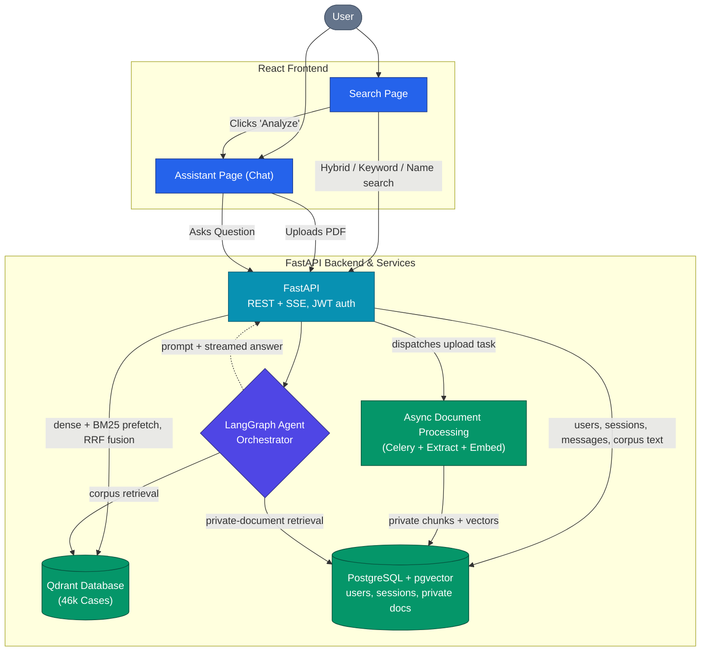

# LexFind

AI-powered legal research and conversational analysis platform. Search across 46,000+ indexed Indian Supreme Court judgments using semantic similarity, chat with specific cases or your own uploaded PDFs, and ask general legal questions — all from a single persistent workspace backed by a LangGraph agent orchestrator.

## Table of Contents

- [Features](#features)
- [Architecture](#architecture)
- [Tech Stack](#tech-stack)
- [Project Structure](#project-structure)
- [Quick Start](#quick-start)
- [Environment Variables](#environment-variables)
- [Documentation](#documentation)
- [RAG Metrics & Evaluation](#rag-metrics--evaluation)

## Features

**Semantic Search**
Natural language search over 46,456 pre-indexed Indian Supreme Court judgments. Queries are embedded using `sentence-transformers/all-mpnet-base-v2` and searched against a Qdrant vector database (1.1M+ vectors) with hybrid retrieval — dense vectors fused with BM25 sparse vectors via Reciprocal Rank Fusion. Results include metadata filters for court, year, state, and case type.

**Agentic RAG Chat**
Every chat request flows through a 14-node LangGraph state machine that classifies intent, guards against off-topic input, and routes to one of four execution paths: general legal knowledge, a summary of a named case, statute or concept, document-specific RAG, or full corpus search (a fifth terminal node rejects off-topic requests). The number of LLM calls varies by path (see [docs/agent.md](docs/agent.md) for the per-path breakdown and the node list). Before answering, the agent rewrites the query, retrieves, grades the retrieved passages with a second model, and retries once with an adapted strategy when the grade is low. Citations are built directly from Qdrant payload metadata — no LLM extraction.

**Private PDF Upload**
Users can upload their own PDFs. A Celery worker asynchronously extracts text via PyMuPDF, chunks it with LangChain, generates 768-dim embeddings, and stores them in the private pgvector store isolated by `owner_id`. Private documents never interact with the shared Qdrant corpus. Note: LLM inference is done via the Groq API — uploaded document content is sent to Groq's API when you chat with it, so do not upload genuinely confidential material.

**Document-Specific Chat**
Clicking Analyze on a corpus search result or uploading a private PDF attaches it to a chat session. The agent automatically searches the correct vector store: Qdrant (filtered by document ID) for corpus cases, pgvector for private uploads. Both paths produce cited, grounded answers.

**Session Management**
Conversations are persistent and multi-document. Each session stores ordered messages, attached documents, and citations in PostgreSQL. Sessions are strictly isolated by `user_id` and `session_id` — every API request re-validates JWT ownership before any data is read or written.

## Architecture



Infrastructure layers:

- **FastAPI** handles HTTP, JWT auth, session ownership, and SSE streaming.
- **LangGraph** orchestrates intent classification and retrieval routing.
- **Celery + RabbitMQ** processes document uploads asynchronously.
- **PostgreSQL + pgvector** stores relational data and private document vectors.
- **Qdrant** stores the 46k-case shared corpus (1.1M vectors, metadata indexed).
- **Groq** runs `openai/gpt-oss-120b` and `openai/gpt-oss-20b` for LLM inference.

## Tech Stack

| Component | Technology |
|---|---|
| Frontend | React 18, Vite, TailwindCSS |
| Backend | FastAPI, Python 3.11+, SQLAlchemy, Alembic |
| Agent Orchestration | LangGraph, LangChain |
| Task Queue | Celery, RabbitMQ |
| Database | PostgreSQL 17, pgvector |
| Vector Store (Corpus) | Qdrant |
| LLM | Groq openai/gpt-oss-120b (primary), openai/gpt-oss-20b |
| Embeddings | sentence-transformers/all-mpnet-base-v2 (768-dim) |
| PDF Processing | PyMuPDF, LangChain RecursiveCharacterTextSplitter |
| File Storage | Local Storage (USE_LOCAL_FILES=true) |
| Deployment | Local Docker Compose (current demo); Azure VM + Azure Static Web Apps (historical deployment) |

## Project Structure

```
LexFind/
├── .github/workflows/ci.yml     # pytest on every push and pull request
├── backend/
│   ├── alembic/                 # Database migrations (0001-0005)
│   ├── app/
│   │   ├── agents/              # LangGraph agent orchestrator
│   │   │   ├── graph.py         # Compiled StateGraph (14 nodes; `blocked` node inline)
│   │   │   ├── state.py         # LexFindState TypedDict
│   │   │   └── nodes/
│   │   │       ├── classifier.py           # intent + guardrail
│   │   │       ├── query_enhancement.py    # standalone-query rewrite (gpt-oss-20b)
│   │   │       ├── recency_check.py        # recent-law cue detection
│   │   │       ├── corpus_search.py        # corpus retrieval (Qdrant)
│   │   │       ├── document_chat.py        # in-document retrieval (Qdrant or pgvector)
│   │   │       ├── retrieval_grader.py     # grades the retrieved passages
│   │   │       ├── corpus_re_retrieval.py  # retry: relaxed hybrid / sparse / dense
│   │   │       ├── document_re_retrieval.py# retry inside an attached document
│   │   │       ├── web_augment.py          # optional Tavily supplementation
│   │   │       ├── graceful_degradation.py # uncertainty note when evidence stays weak
│   │   │       ├── response_generation.py  # prompt assembly
│   │   │       ├── general_chat.py         # general legal Q&A
│   │   │       ├── general_summary.py      # summary of a named case/statute/concept
│   │   │       ├── _embedder.py            # shared embedding helper
│   │   │       └── _qdrant.py              # shared Qdrant client
│   │   ├── api/                 # FastAPI routers
│   │   │   ├── auth.py          # Register, login, profile
│   │   │   ├── sessions.py      # Chat sessions + SSE streaming
│   │   │   ├── documents.py     # PDF upload, attach, status, PDF streaming
│   │   │   ├── cases.py         # Corpus case detail, analyze, similar cases
│   │   │   ├── search.py        # Hybrid / keyword / party-name search, PDF route
│   │   │   └── dependencies/    # JWT validation dependency
│   │   ├── core/                # LLM client, rate limiter, exceptions
│   │   ├── db/                  # SQLAlchemy models, config, crud, session
│   │   ├── schemas/             # Pydantic request/response models
│   │   ├── services/            # Embedding, Qdrant retrieval, blob storage, processing
│   │   ├── workers/             # Celery app + document processing task
│   │   └── main.py              # App factory
│   ├── data/                    # git-ignored: corpus PDFs, user uploads
│   ├── scripts/
│   │   ├── qdrant_ingestion/    # metadata extraction, embedding, corpus loading
│   │   ├── hybrid/              # hybrid ingestor, collection setup, evaluation harness
│   │   └── faiss_ingestion/     # original prototype indexer
│   ├── tests/                   # 20 pytest tests (mock-based, no live services)
│   └── requirements.txt
├── frontend/
│   └── src/
│       ├── components/          # Navigation, Footer, ProtectedRoute
│       ├── config/apiClient.js  # Typed fetch wrappers for the REST API
│       ├── context/             # React Auth context (JWT storage)
│       └── pages/               # Landing, Search, Assistant, Login
├── docs/                        # Technical documentation
├── docker-compose.yml           # qdrant, db, rabbitmq, redis, migrate, api, celery_worker
└── README.md
```

## Quick Start

### Prerequisites

- Python 3.11+
- Node.js 18+
- Docker and Docker Compose
- Groq API key from console.groq.com
- A folder of judgment PDFs if you want to build the corpus index yourself (see step 5)

### Backend

```bash
# 1. Start infrastructure (Qdrant is part of the stack; Redis only enables rate limiting)
docker compose up -d db rabbitmq qdrant

# 2. Set up Python environment
cd backend
python -m venv venv
# Windows: .\venv\Scripts\activate
# Linux/Mac: source venv/bin/activate
pip install -r requirements.txt

# 3. Configure environment
cp .env.example .env
# Edit .env — set GROQ_API_KEY, JWT_SECRET_KEY, DATABASE_URL, CELERY_BROKER_URL

# 4. Run database migrations
alembic upgrade head

# 5. Load the corpus (required before search or corpus chat returns anything)
#    The judgment PDFs and the generated vectors are not committed to this repository.
#    Index your own PDF folder with the scripts in backend/scripts/ — the payload schema,
#    collection name and step order are documented in docs/setup_and_installation.md
#    ("Qdrant Corpus Loading").

# 6. Start API server
uvicorn app.main:create_app --factory --host 0.0.0.0 --port 8000 --reload

# 7. Start Celery worker (separate terminal)
celery -A app.workers.celery_app worker --loglevel=info -Q lexfind_documents
```

The whole stack, including the API and worker containers, can also be started with
`docker compose up -d --build` — that is the recommended path for a demonstration.

### Frontend

```bash
cd frontend
npm install
npm run dev
```

Open `http://localhost:5173`.

## Environment Variables

### Backend (`backend/.env`)

| Variable | Description |
|---|---|
| `DATABASE_URL` | PostgreSQL connection string |
| `CELERY_BROKER_URL` | RabbitMQ connection string (Celery broker) |
| `CELERY_RESULT_BACKEND` | Celery result backend (PostgreSQL) |
| `GROQ_API_KEY` | Required for LLM inference |
| `GROQ_MODEL` | Main LLM (default: `openai/gpt-oss-120b`; the rewrite/grade/relax nodes use `openai/gpt-oss-20b`) |
| `JWT_SECRET_KEY` | JWT signing key — must be at least 32 characters and not a known placeholder |
| `JWT_ALGORITHM` | Signing algorithm (default: HS256) |
| `JWT_EXPIRATION_HOURS` | Token lifetime (default: 24) |
| `QDRANT_HOST` / `QDRANT_PORT` | Qdrant endpoint (defaults: localhost / 6333) |
| `QDRANT_URL` / `QDRANT_API_KEY` | Optional remote/Qdrant Cloud endpoint; when `QDRANT_URL` is set it takes precedence over host/port |
| `QDRANT_COLLECTION` | Collection name (default: `legal_corpus_hybrid`) |
| `QDRANT_QUERY_TIMEOUT_SECONDS` | Fuse timeout before falling back to dense-only (default: 12) |
| `USE_LOCAL_FILES` | `true` keeps PDFs on local disk instead of Azure Blob Storage |
| `PDF_DIR` | Folder the ingestion scripts read judgment PDFs from |
| `AZURE_STORAGE_CONNECTION_STRING` | Optional, enables Azure Blob Storage |
| `REDIS_URL` | Optional, enables Redis rate limiting |
| `TAVILY_API_KEY` | Optional, enables web supplementation for recent-law questions |
| `HOST` / `PORT` / `RELOAD` | Read by the `python -m app.main` entry point (defaults: 127.0.0.1 / 8000 / false); the Dockerfile CMD binds 0.0.0.0:8000 directly |

### Frontend (`frontend/.env`)

| Variable | Description |
|---|---|
| `VITE_API_BASE_URL` | Backend URL (default: http://localhost:8000) |

`VITE_API_BASE_URL` is also read server-side by [backend/app/api/cases.py](backend/app/api/cases.py) when it builds the PDF streaming URL, so set it in the backend environment too if the API is not served from the same origin as the client.

## RAG Metrics & Evaluation

Retrieval was measured empirically against 192 randomly sampled judgments × 3 query types (excerpt, case title, single sentence) = 576 queries per mode. The same query set was run against the FAISS prototype, then against the Qdrant index in dense-only and hybrid modes (dense + BM25 sparse fused via Reciprocal Rank Fusion); the harness in `backend/scripts/hybrid/hybrid_eval.py` also re-checks metadata payload filters on the hybrid path.

Fusion was the decisive change. Averaged over the three query types, Hit@5 went from 21.5% with dense-only retrieval to 60.9% with hybrid — a 2.83× gain, and 227 more of the 576 questions answered inside the top five. Per type: excerpts 35.9% → **82.3%**, single sentences 19.8% → 74.5%, case titles 8.9% → 26.0%. Hybrid also cut latency on every query type (e.g. 462 ms → 341 ms on excerpts).

The full numbers — Hit@1/3/5 and latency for all three stages, and the per-type breakdown — are in **[docs/rag_metrics.md](docs/rag_metrics.md)**. Note: the 46k-judgment corpus and the raw evaluation output files are git-ignored and not committed to this repository, so the experiments cannot be re-run from the repo alone; the figures above are read from the runs documented in that report.

## Documentation

Detailed technical documentation is available in the `docs/` directory:

- [System Overview & Architecture](docs/overview.md)
- [Setup & Installation](docs/setup_and_installation.md)
- [Local Demo Script (for evaluations)](docs/demo_script.md)
- [Data Flows & API Design](docs/data_flows.md)
- [LangGraph Agent Orchestrator](docs/agent.md)
- [Database Schema & Migrations](docs/database.md)
- [API Reference](docs/api_reference.md)
- [RAG Search Accuracy Metrics](docs/rag_metrics.md)
